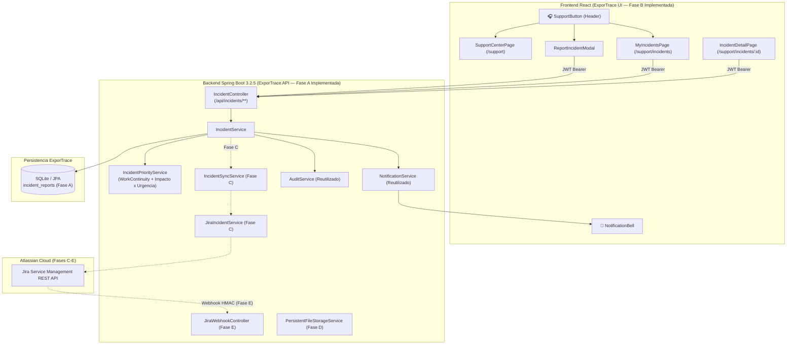

# Arquitectura del Centro de Soporte y Gestión de Incidencias (Integración Jira Service Management)

**Sistema Inteligente de Trazabilidad Hidrobiológica ExporTrace**  
*Documento Técnico Canónico — Actualizado al Cierre de FASE A y FASE B*

---

## 📌 1. Propósito y Alcance del Módulo

El módulo de **Centro de Soporte y Gestión de Incidencias** de **ExporTrace** permite a cualquier usuario autenticado de la plataforma (`PRODUCCION`, `QA`, `LOGISTICA`, `GERENCIA`, `ADMINISTRADOR`, `SUPERADMIN`) reportar problemas técnicos u operativos, adjuntar evidencias, realizar seguimiento en tiempo real, intercambiar comentarios públicos con el equipo de soporte TI y recibir notificaciones de cambios de estado **sin abandonar la interfaz de ExporTrace ni requerir una licencia o cuenta de usuario directo en Jira**.

Por su parte, **Jira Service Management (JSM)** opera como la herramienta **ITSM** (*IT Service Management*) de back-office para la mesa de ayuda TI, encargándose de:
- Recepción centralizada en colas de soporte.
- Asignación de agentes especialistas.
- Autoridad operacional definitiva del acuerdo de nivel de servicio (SLA) una vez sincronizado el ticket.
- Escalamiento técnico (Nivel 1 $\rightarrow$ Nivel 2 / Infraestructura / Base de Datos).
- Diagnóstico, resolución y cierre formal.

---

## 🏛️ 2. Decisiones Arquitectónicas y Funcionales Definitivas

1. **Prohibición de Conexión Directa Frontend $\rightarrow$ Jira**:  
   El cliente React **nunca** se comunica con `*.atlassian.net`. Toda comunicación se realiza exclusivamente hacia el backend de ExporTrace (`/api/incidents/**`), y es el backend Spring Boot quien consumirá la API REST de Jira Service Management en las fases posteriores (Fase C+).
2. **Custodia Exclusiva de Credenciales en Servidor**:  
   `JIRA_API_TOKEN` se utilizará exclusivamente para la futura integración backend académica y `JIRA_WEBHOOK_SECRET` para la validación criptográfica HMAC del webhook futuro. Ningún secreto reside en `application.properties` versionado ni en el cliente React.
3. **Urgencia Guiada por Continuidad Operativa (`WorkContinuity`)**:  
   No se infiere la urgencia únicamente por el módulo. El formulario guía al usuario con la pregunta: **"¿Puedes continuar con tu trabajo?"**:
   - `NO_PUEDE_CONTINUAR` $\rightarrow$ `IncidentUrgency.HIGH`
   - `CONTINUA_PARCIALMENTE` $\rightarrow$ `IncidentUrgency.MEDIUM`
   - `PUEDE_CONTINUAR` $\rightarrow$ `IncidentUrgency.LOW`
4. **Cálculo Determinístico de Prioridad en Backend (`IncidentPriorityService`)**:  
   El usuario selecciona el **Impacto** (`HIGH`, `MEDIUM`, `LOW`) y responde la continuidad operativa (`WorkContinuity`), pero **nunca selecciona directamente `P1`, `P2`, `P3` ni `P4`**. `IncidentPriorityService` calcula en el backend la prioridad oficial aplicando las 9 combinaciones de la matriz Impacto $\times$ Urgencia.
5. **Categorías Semánticas (`IncidentCategory`)**:  
   Las categorías se implementan con nombres técnicos legibles (`AUTHENTICATION`, `ACCESS_CONTROL`, `LOTS`, `QUALITY`, `COLD_CHAIN`, `DOCUMENTS`, `CERTIFICATION`, `TRACEABILITY_QR`, `LOGISTICS`, `DASHBOARD`, `NOTIFICATIONS`, `BACKEND_API`, `DATABASE`, `INFRASTRUCTURE`, `OTHER`), manteniendo además su código de catálogo (`CAT-01` a `CAT-15`).
6. **Autoridad del SLA (`LOCAL_ESTIMATE` vs. `JIRA_AUTHORITATIVE`)**:  
   Durante las Fases A y B no se construye un segundo motor paralelo de Jira SLA. Mientras `jiraIssueKey` sea `null`, los campos locales (`slaFirstResponseTargetAt`, `slaResolutionTargetAt`, `slaBreached`) se calculan y exponen únicamente como **`LOCAL_ESTIMATE`** bajo la etiqueta de interfaz **"Tiempo objetivo estimado"**. Después de la sincronización en Fase C+, **Jira Service Management será la autoridad operacional del SLA**, y los campos locales actuarán como proyección sincronizada.
7. **Generación de Código Correlativo (`INC-2026-XXXXXX`) y Garantía de Concurrencia**:  
   - `AtomicLong` + método `synchronized` en `IncidentService.generateUniqueIncidentCode()` protege la concurrencia de hilos dentro de una única instancia JVM.
   - El constraint físico `UNIQUE(code)` en base de datos, acompañado del bucle de reintento ante `DataIntegrityViolationException`, constituye la garantía final de integridad en BD.
   - **Riesgo / evolución futura**: Si en el futuro el despliegue en Render escala horizontalmente a múltiples instancias JVM activas en simultáneo, se evolucionará el generador a una secuencia nativa de base de datos (`SEQUENCE`) o tabla correlativa atómica, sin introducir complejidad de arquitectura distribuida en Fases A/B.

---

## 🔄 3. Diagrama de Arquitectura y Flujo Bidireccional

---

## ⚖️ 4. Matriz Oficial de Priorización y Estimación SLA (`LOCAL_ESTIMATE`)

### 4.1 Mapeo de Continuidad Operativa a Urgencia
| Respuesta a "¿Puedes continuar con tu trabajo?" (`WorkContinuity`) | Urgencia Resultante (`IncidentUrgency`) |
| :--- | :---: |
| `NO_PUEDE_CONTINUAR` | `HIGH` |
| `CONTINUA_PARCIALMENTE` | `MEDIUM` |
| `PUEDE_CONTINUAR` | `LOW` |

### 4.2 Matriz Impacto $\times$ Urgencia (`IncidentPriorityService`)
| Impacto \ Urgencia | `HIGH` | `MEDIUM` | `LOW` |
| :--- | :---: | :---: | :---: |
| **`HIGH`** | **`P1_CRITICAL`** | **`P2_HIGH`** | **`P2_HIGH`** |
| **`MEDIUM`** | **`P2_HIGH`** | **`P3_MEDIUM`** | **`P3_MEDIUM`** |
| **`LOW`** | **`P3_MEDIUM`** | **`P4_LOW`** | **`P4_LOW`** |

### 4.3 Tiempos Objetivo de SLA (`LOCAL_ESTIMATE` durante Fase A/B)
| Prioridad | Etiqueta UI (`IncidentPriorityBadge`) | Primera Respuesta Objetivo | Resolución Objetivo | Autoridad Fase A/B | Autoridad Post-Sync (Fase C+) |
| :--- | :--- | :---: | :---: | :---: | :---: |
| **`P1_CRITICAL`** | `P1 — Crítica` | **15 minutos** | **2 horas (120 min)** | `LOCAL_ESTIMATE` | Jira Service Management |
| **`P2_HIGH`** | `P2 — Alta` | **30 minutos** | **4 horas (240 min)** | `LOCAL_ESTIMATE` | Jira Service Management |
| **`P3_MEDIUM`** | `P3 — Media` | **2 horas (120 min)** | **8 horas (480 min)** | `LOCAL_ESTIMATE` | Jira Service Management |
| **`P4_LOW`** | `P4 — Baja` | **4 horas (240 min)** | **24 horas (1440 min)** | `LOCAL_ESTIMATE` | Jira Service Management |

---

## 🔐 5. Matriz RBAC Real y Mapeo de Authorities en Spring Security

En ExporTrace (`DataInitializer.java` y `JwtAuthFilter.java`), el catálogo canónico de roles de negocio en la tabla `roles` **no utiliza `ADMIN`**, sino **`ADMINISTRADOR`** y **`SUPERADMIN`**. `JwtAuthFilter` inyecta la autoridad anteponiendo el prefijo `ROLE_`:

| Rol de Negocio (`Role.nombre`) | Authority en Spring Security (`JwtAuthFilter`) | Rutas UI (`/support`, `/support/incidents`, `/support/incidents/:id`) | `POST /api/incidents` & `GET /api/incidents/my` | `GET /api/incidents/{id}` | `GET /api/admin/incidents` |
| :--- | :--- | :---: | :---: | :---: | :---: |
| **`PRODUCCION`** | `ROLE_PRODUCCION` | Habilitadas | `201` / `200` (Propias) | `200` si es propietario / `403` si es ajena | **`403 Forbidden`** |
| **`QA`** | `ROLE_QA` | Habilitadas | `201` / `200` (Propias) | `200` si es propietario / `403` si es ajena | **`403 Forbidden`** |
| **`LOGISTICA`** | `ROLE_LOGISTICA` | Habilitadas | `201` / `200` (Propias) | `200` si es propietario / `403` si es ajena | **`403 Forbidden`** |
| **`GERENCIA`** | `ROLE_GERENCIA` | Habilitadas | `201` / `200` (Propias) | `200` si es propietario / `403` si es ajena | **`403 Forbidden`** |
| **`ADMINISTRADOR`** | `ROLE_ADMINISTRADOR` | Habilitadas | `201` / `200` (Propias) | **`200 OK`** (Supervisión global) | **`200 OK`** |
| **`SUPERADMIN`** | `ROLE_SUPERADMIN` | Habilitadas | `201` / `200` (Propias) | **`200 OK`** (Supervisión global) | **`200 OK`** |

---

## ♻️ 6. Matriz de Reutilización de Componentes (Fases A y B)

| Componente | Estado | Clasificación | Detalle |
| :--- | :---: | :---: | :--- |
| `JwtAuthFilter` & `JwtUtil` | Activo | **REUTILIZADO** | Verifica `user.getActivo()` en cada request (`INC-A14` / `INC-12`, `INC-A15`). |
| `User`, `Lot`, `AuditService`, `NotificationService`, `GlobalExceptionHandler` | Activo | **REUTILIZADO** | Relaciones JPA, auditoría inmutable, notificaciones y respuestas de error estandarizadas. |
| `Modal.tsx`, `DataTable.tsx`, `Button.tsx`, `Input.tsx`, `AlertCard.tsx` | Activo | **REUTILIZADO** | Componentes base de UI reutilizados en `ReportIncidentModal`, `MyIncidentsPage` e `IncidentDetailPage`. |
| `Header.tsx`, `Sidebar.tsx`, `App.tsx`, `role.guard.ts`, `apiClient.ts` | Extendido | **EXTENDIDO** | Incorporan `SupportButton` (`LifeBuoy`), sección `SOPORTE` en menú lateral, rutas `/support/**` y propagación de `status`/`fieldErrors`. |
| `SupportButton`, `ReportIncidentModal`, `IncidentPriorityBadge`, `IncidentStatusBadge`, `IncidentTimeline`, `SupportCenterPage`, `MyIncidentsPage`, `IncidentDetailPage` | Implementado | **NUEVO (Fase B)** | Experiencia completa de usuario para el Centro de Soporte conectada a la API local de Fase A. |
