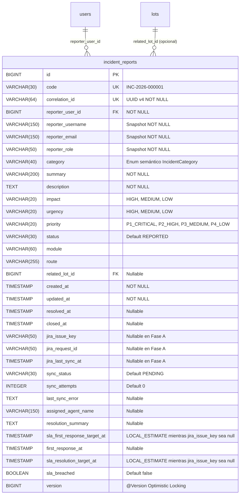

# Modelo de Datos y Especificación API — Gestión de Incidencias (ExporTrace ↔ Jira)

**Sistema Inteligente de Trazabilidad Hidrobiológica ExporTrace**  
*Documento Técnico Canónico — Actualizado con Implementación y Corrección de Consistencia de FASE A*

---

## 📌 1. Entidad Implementada en Fase A: `IncidentReport`

Tabla física en SQLite / JPA: **`incident_reports`**



### 1.1 Constraints e Índices Creados en `incident_reports`
1. `CONSTRAINT uk_incident_code UNIQUE (code)` + `idx_uk_incident_code`
2. `CONSTRAINT uk_incident_correlation_id UNIQUE (correlation_id)` + `idx_uk_incident_correlation_id`
3. `idx_incident_reporter_user ON incident_reports(reporter_user_id)`
4. `idx_incident_status ON incident_reports(status)`
5. `idx_incident_priority ON incident_reports(priority)`
6. `idx_incident_sync_status ON incident_reports(sync_status)`
7. `idx_incident_created_at ON incident_reports(created_at)`

### 1.2 Nota de Concurrencia en la Generación del Código `code` (`INC-2026-XXXXXX`)
- **`AtomicLong` + `synchronized`**: Protege la generación secuencial frente a hilos concurrentes dentro de una única instancia JVM.
- **`UNIQUE (code)` + Reintento Controlado**: El constraint único en base de datos (`uk_incident_code`) sigue siendo la garantía final de integridad; si ocurre una colisión (`DataIntegrityViolationException`), `IncidentService` reintenta de forma transparente.
- **Riesgo / Evolución Futura (Multi-instancia Render)**: Si en el futuro el servicio se despliega con escalamiento horizontal (múltiples instancias JVM en Render atacando la misma BD), se evolucionará a una secuencia nativa de BD o tabla de correlativos atómicos. No se introduce arquitectura distribuida en Fase A.

---

## 🔢 2. Enums Semánticos Implementados (`com.exportrace.entity.enums`)

### 2.1 `IncidentCategory`
| Nombre Técnico Enum | Código Catálogo (`catalogCode`) | Etiqueta Funcional (`label`) | Módulo por Defecto (`defaultModule`) |
| :--- | :---: | :--- | :--- |
| `AUTHENTICATION` | `CAT-01` | Autenticación y sesiones | `AUTENTICACION` |
| `ACCESS_CONTROL` | `CAT-02` | Usuarios, roles y permisos | `ADMINISTRACION` |
| `LOTS` | `CAT-03` | Registro y gestión de lotes | `LOTES` |
| `QUALITY` | `CAT-04` | Calidad / QA | `CALIDAD` |
| `COLD_CHAIN` | `CAT-05` | Cadena de frío | `FRIO` |
| `DOCUMENTS` | `CAT-06` | Documentos y evidencias | `DOCUMENTOS` |
| `CERTIFICATION` | `CAT-07` | Certificación sanitaria | `CERTIFICACION` |
| `TRACEABILITY_QR` | `CAT-08` | QR y trazabilidad | `TRAZABILIDAD` |
| `LOGISTICS` | `CAT-09` | Logística y despacho | `LOGISTICA` |
| `DASHBOARD` | `CAT-10` | Dashboard y reportes | `DASHBOARD` |
| `NOTIFICATIONS` | `CAT-11` | Notificaciones | `NOTIFICATIONS` |
| `BACKEND_API` | `CAT-12` | Backend / API | `SISTEMA` |
| `DATABASE` | `CAT-13` | Base de datos | `SISTEMA` |
| `INFRASTRUCTURE` | `CAT-14` | Infraestructura / Render | `SISTEMA` |
| `OTHER` | `CAT-15` | Otro | `SISTEMA` |

### 2.2 `WorkContinuity` (Pregunta Guiada de Urgencia)
- `NO_PUEDE_CONTINUAR` $\rightarrow$ `IncidentUrgency.HIGH`
- `CONTINUA_PARCIALMENTE` $\rightarrow$ `IncidentUrgency.MEDIUM`
- `PUEDE_CONTINUAR` $\rightarrow$ `IncidentUrgency.LOW`

### 2.3 `IncidentPriority` y SLA Inicial (`LOCAL_ESTIMATE`)
| Enum `IncidentPriority` | Etiqueta (`label`) | Prioridad Jira (`jiraPriorityName`) | Primera Respuesta (`slaFirstResponseMinutes`) | Resolución Objetivo (`slaResolutionMinutes`) |
| :--- | :--- | :---: | :---: | :---: |
| **`P1_CRITICAL`** | `P1 - Crítica` | `Highest` | **15 min** | **120 min (2 horas)** |
| **`P2_HIGH`** | `P2 - Alta` | `High` | **30 min** | **240 min (4 horas)** |
| **`P3_MEDIUM`** | `P3 - Media` | `Medium` | **120 min (2 horas)** | **480 min (8 horas)** |
| **`P4_LOW`** | `P4 - Baja` | `Low` | **240 min (4 horas)** | **1440 min (24 horas)** |

> **Nota sobre Autoridad del SLA**: Estos tiempos son exclusivamente **`LOCAL_ESTIMATE`** durante las Fases A y B mientras `jiraIssueKey` sea `null`. Tras la sincronización con Jira Service Management en Fase C+, Jira será la autoridad operacional del SLA.

### 2.4 Otros Enums Implementados
- **`IncidentImpact`**: `HIGH`, `MEDIUM`, `LOW`
- **`IncidentUrgency`**: `HIGH`, `MEDIUM`, `LOW`
- **`IncidentStatus`**: `REPORTED`, `TRIAGE`, `IN_PROGRESS`, `WAITING_USER`, `ESCALATED`, `RESOLVED`, `CLOSED`, `REOPENED`
- **`JiraSyncStatus`**: `PENDING`, `SYNCED`, `ERROR`, `RETRY_PENDING`

---

## 🌐 3. Endpoints Implementados en FASE A (`IncidentController`)

### 3.1 `POST /api/incidents`
- **Autenticación**: Requerida (JWT Bearer de usuario con `activo == true`).
- **Request (`CreateIncidentRequest`)**:
  ```json
  {
    "category": "COLD_CHAIN",
    "summary": "Fallo en registro de sensor térmico cámara 02",
    "description": "El sensor T-02 no permite guardar lecturas negativas en el lote activo.",
    "impact": "HIGH",
    "workContinuity": "NO_PUEDE_CONTINUAR",
    "module": "FRIO",
    "route": "/quality/coldchain",
    "relatedLotId": 1
  }
  ```
- **Protección de Contrato**: `CreateIncidentRequest` ignora cualquier campo no autorizado (`priority`, `status`, `syncStatus`, `jiraIssueKey`, `reporterEmail`, `reporterUserId`). Todos son calculados y asignados exclusivamente por el backend.
- **Response (`201 Created` - `IncidentDTO`)**: Devuelve `id`, `code` (`INC-2026-000001`), `category`, `categoryCode`, `summary`, `description`, `impact`, `urgency`, `priority`, `status` (`REPORTED`), `syncStatus` (`PENDING`), `slaFirstResponseTargetAt`, `slaResolutionTargetAt` y `slaAuthority` (`LOCAL_ESTIMATE`).

### 3.2 `GET /api/incidents/my`
- **Autenticación**: Requerida.
- **Regla**: Retorna exclusivamente las incidencias donde `reporterUser.id == authenticatedUser.id`, ordenadas por `createdAt DESC`.

### 3.3 `GET /api/incidents/{id}`
- **Autenticación**: Requerida.
- **Regla de Aislamiento**:
  - Si el usuario es operacional (`PRODUCCION`, `QA`, `LOGISTICA`, `GERENCIA`) y no es el propietario de la incidencia, retorna **`403 Forbidden`** y registra en `audit_logs` el evento **`INCIDENT_VIEW_DENIED`** con resultado `DENEGADO`.
  - Si es el propietario o posee rol canónico **`ADMINISTRADOR`** (`ROLE_ADMINISTRADOR`) o **`SUPERADMIN`** (`ROLE_SUPERADMIN`), retorna `200 OK` con el `IncidentDTO`.

### 3.4 `GET /api/admin/incidents`
- **Autorización Real**: `@PreAuthorize("hasAnyRole('ADMINISTRADOR', 'SUPERADMIN')")`.
- **Mapeo RBAC**:
  - `Role.nombre = "ADMINISTRADOR"` $\rightarrow$ `SimpleGrantedAuthority("ROLE_ADMINISTRADOR")` $\rightarrow$ **`200 OK`**
  - `Role.nombre = "SUPERADMIN"` $\rightarrow$ `SimpleGrantedAuthority("ROLE_SUPERADMIN")` $\rightarrow$ **`200 OK`**
  - Roles operacionales (`PRODUCCION`, `QA`, `LOGISTICA`, `GERENCIA`) $\rightarrow$ **`403 Forbidden`**
  - *(Nota: No existe ni se utiliza un rol `ADMIN` en el catálogo canónico de ExporTrace).*

---

## ⏳ 4. Entidades y Endpoints Previstos para Fases Posteriores (Fases C – E)
- **Fase C**: `POST /api/admin/incidents/{id}/retry-sync`, `JiraIncidentService`, `IncidentSyncService`.
- **Fase D**: `IncidentComment`, `IncidentAttachment`, `POST/GET /api/incidents/{id}/comments`, `POST/GET /api/incidents/{id}/attachments`, `POST /api/incidents/{id}/reopen`.
- **Fase E**: `JiraWebhookEvent`, `POST /api/integrations/jira/webhook` con validación HMAC (`JIRA_WEBHOOK_SECRET`).
