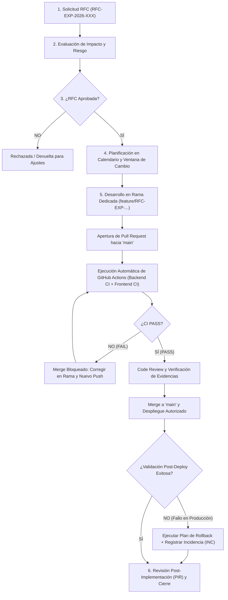

# Plan Formal de Control de Cambios — ExporTrace

**Curso:** Taller Integrador II — Semana 11: Control de Cambios e Integración Continua  
**Sistema:** Sistema Inteligente de Trazabilidad Hidrobiológica ExporTrace  
**Versión:** 1.0  
**Estado:** Vigente (Integrado con GitHub Actions `VALIDADO_GITHUB_ACTIONS`)

---

## 1. Objetivo del Plan

Establecer un procedimiento formal, auditable y obligatorio de **Gestión y Control de Cambios (Change Management)** para gobernar toda modificación técnica, funcional, estructural o de configuración realizada sobre la plataforma **ExporTrace**, reduciendo el riesgo de:

- Errores o caídas en el entorno productivo (Render).
- Pérdida o corrupción de información de trazabilidad hidrobiológica, calidad (QA), cadena de frío, certificación SANIPES/HACCP o incidencias.
- Regresiones sobre las **25 casuísticas de Integrador 2** y las casuísticas de Gestión de Incidencias (**118 pruebas automatizadas actuales**).
- Interrupciones operativas durante ventanas críticas o evaluaciones académicas.
- Cambios no autorizados o commits directos sobre la rama principal (`main`).
- Incompatibilidades de contrato entre `exportrace-ica-backend` (Spring Boot) y `exportrace-ica-frontend` (React/Vite).
- Modificaciones de esquema de base de datos sin respaldo ni migración idempotente.
- Despliegues sin validación en Integración Continua (GitHub Actions) o sin plan de reversión (*Rollback*).

---

## 2. Alcance

El presente Plan de Control de Cambios aplica obligatoriamente a los siguientes activos y capas de ExporTrace:

| Dominio / Capa | Componentes Sujetos a Control de Cambios |
| :--- | :--- |
| **1. Aplicación Backend (`exportrace-ica-backend`)** | Código fuente Java 21 / Spring Boot 3.2.5, reglas de negocio (`LotStateMachineService`, `QualityService`, `ColdChainService`, `CertificationService`, `IncidentService`, `IncidentPriorityService`), controladores REST (`/api/**`), seguridad (`SecurityConfig`, `JwtAuthFilter`, RBAC), dependencias en `pom.xml` y propiedades en `application.properties`. |
| **2. Aplicación Frontend (`exportrace-ica-frontend`)** | Componentes React 19 / TypeScript, vistas operativas y de soporte, rutas y guardas (`role.guard.ts`), clientes HTTP (`apiClient.ts`, `incidentService.ts`), dependencias en `package.json` / `package-lock.json` y configuración de Vite. |
| **3. Base de Datos (`SQLite` / `PostgreSQL`)** | Esquema relacional, entidades JPA (`@Entity`), migraciones en `DatabaseMigrationConfig.java`, índices, restricciones de unicidad (`UNIQUE`), bloqueos optimistas (`@Version`) y datos semilla (`DataInitializer.java`). |
| **4. Infraestructura y Despliegue** | Servicios web en Render (`exportrace-backend`, `exportrace-frontend`), variables de entorno (`SPRING_DATASOURCE_URL`, `JWT_SECRET`, `CORS_ALLOWED_ORIGINS`, `JIRA_*`), almacenamiento en Persistent Disk (`data/uploads`) y parámetros de red/timeouts. |
| **5. Integraciones Externas** | Integración REST con Jira Service Management Cloud (`JiraIncidentService`, `IncidentSyncService`), futuros webhooks entrantes y cualquier servicio externo. |
| **6. Documentación Técnica (`/docs`)** | Documentos de arquitectura, modelo de datos, matrices de casuísticas, guías de configuración Jira, calendario de cambios y plantillas RFC/PIR. |
| **7. Integración Continua (CI)** | Workflows de GitHub Actions (`.github/workflows/ci.yml`), reglas de protección de rama (*Branch Protection*) y políticas de construcción de artefactos. |

---

## 3. Clasificación de Tipos de Cambio

Toda solicitud de modificación sobre ExporTrace debe clasificarse en uno de los tres tipos formales siguientes:

### 3.1 Cambio Estándar (`STANDARD`)
- **Características:**
  - Bajo riesgo técnico y operativo.
  - Frecuente o repetitivo.
  - Procedimiento de ejecución y validación previamente conocido y estandarizado.
  - No altera contratos de API, esquema de base de datos ni reglas de seguridad.
- **Ejemplos en ExporTrace:**
  - Corrección ortográfica o ajuste de etiquetas de interfaz en un componente React.
  - Ajuste visual menor de estilos Tailwind CSS sin alterar flujo de formularios.
  - Actualización de documentación en `/docs`.
  - Ajuste de parámetro de configuración menor previamente probado.
  - Actualización menor (patch) de una dependencia sin impacto funcional crítico.
- **Nivel de Aprobación:** Aprobación simplificada preautorizada por el **Líder Técnico**, manteniendo obligatorio el flujo de rama + Pull Request + GitHub Actions `PASS`.

### 3.2 Cambio Normal (`NORMAL`)
- **Características:**
  - Modificación no trivial que introduce, altera o retira funcionalidad, estructura de datos, seguridad o integraciones.
  - Requiere registro formal de **RFC (Request for Change)**, análisis técnico, evaluación de impacto y riesgo, plan de pruebas, plan de rollback, autorización previa y ventana de implementación planificada.
- **Ejemplos en ExporTrace:**
  - Incorporación de un nuevo módulo o fase (ej. Centro de Soporte o integración con Jira Service Management).
  - Modificación de reglas de negocio de inspecciones QA, cadena de frío o máquina de estados de lotes.
  - Creación o alteración de endpoints REST o DTOs entre Backend y Frontend.
  - Modificación del esquema de base de datos (nuevas tablas como `incident_reports` o cambio de cardinalidad `1:1` a `1:N` en `quality_inspections`).
  - Cambios en autenticación JWT, desactivación de usuarios o matriz RBAC (`ADMINISTRADOR`, `SUPERADMIN`, roles operativos).
- **Nivel de Aprobación:** Aprobación previa obligatoria del **Líder Técnico** y **Product Owner** (y del **CAB** completo cuando el riesgo sea `ALTO` o `CRÍTICO`).

### 3.3 Cambio de Emergencia (`EMERGENCY`)
- **Características:**
  - Intervención urgente e impostergable requerida para restaurar un servicio caído, corregir una vulnerabilidad crítica de seguridad, impedir pérdida/corrupción de datos o desbloquear un flujo operativo crítico detenido en producción.
- **Ejemplos en ExporTrace:**
  - Caída total del servicio Backend en Render (`HTTP 502/503`) o bloqueo de conexión a base de datos.
  - Vulnerabilidad crítica en validación de tokens JWT o exposición accidental de credenciales/tokens.
  - Error bloqueante en producción que impide certificar o despachar lotes aprobados.
  - Fallo grave que provoca pérdida de evidencias fotográficas o corrupción de registros.
- **Nivel de Aprobación:** Proceso acelerado autorizado de inmediato por el **Responsable de Operaciones/Despliegue** o **Líder Técnico** disponible. **Obligatoriamente** debe documentarse su RFC y ejecutarse una **Revisión Post-Implementación (PIR)** una vez restablecido el servicio.

---

## 4. Flujo Oficial del Proceso de Control de Cambios

El ciclo de vida canónico de todo cambio en ExporTrace consta de **6 etapas**:

1. **Solicitud RFC (`Request for Change`)**
2. **Evaluación Técnica y de Riesgo**
3. **Autorización (Líder Técnico / CAB)**
4. **Planificación y Calendarización**
5. **Implementación Controlada (Rama $\rightarrow$ PR $\rightarrow$ GitHub Actions CI $\rightarrow$ Code Review $\rightarrow$ Merge $\rightarrow$ Deploy)**
6. **Revisión Post-Implementación (`PIR`) y Cierre**

### Diagrama de Flujo del Proceso (Mermaid)

---

## 5. Evaluación de Riesgo e Impacto

Cada RFC debe ser evaluada combinando la **Probabilidad de falla** (`BAJA`, `MEDIA`, `ALTA`) y el **Impacto potencial** (`BAJO`, `MEDIO`, `ALTO`) sobre la operación de ExporTrace.

### 5.1 Matriz `Probabilidad × Impacto`

| Probabilidad \ Impacto | Impacto BAJO | Impacto MEDIO | Impacto ALTO |
| :--- | :---: | :---: | :---: |
| **Probabilidad ALTA** | `MEDIO` | `ALTO` | **`CRÍTICO`** |
| **Probabilidad MEDIA** | `BAJO` | `MEDIO` | `ALTO` |
| **Probabilidad BAJA** | `BAJO` | `BAJO` | `MEDIO` |

### 5.2 Dimensiones y Criterios Objetivos de Evaluación

| Dimensión Evaluada | Riesgo `BAJO` | Riesgo `MEDIO` | Riesgo `ALTO` / `CRÍTICO` |
| :--- | :--- | :--- | :--- |
| **Usuarios y Operación** | Cosmético o informativo; no afecta tareas operativas. | Afecta una vista secundaria con alternativa operativa. | Afecta flujo principal de Lotes, QA, Frío, Certificación, Despacho o Soporte. |
| **Seguridad y RBAC** | Sin cambios en permisos ni autenticación. | Ajuste de validaciones de entrada en un endpoint existente. | Cambios en `SecurityConfig`, `JwtAuthFilter`, contraseñas, tokens o matriz RBAC. |
| **Base de Datos** | Sin cambios de esquema ni migraciones. | Nuevos campos opcionales (`nullable`) o índices sin alterar datos previos. | Reestructuración de tablas/relaciones (ej. `1:1` a `1:N`), constraints `NOT NULL` o migración de datos existentes. |
| **Integración Externa** | Sin llamadas externas nuevas. | Ajuste en cliente externo con feature flag deshabilitado por defecto. | Activación productiva de credenciales externas, webhooks o cambios de contrato API. |
| **Disponibilidad / SLA** | Cero tiempo de inactividad (*Zero downtime*). | Reinicio breve de contenedor (< 1 min). | Requiere ventana de mantenimiento o impacta cálculo de SLA / operación en vivo. |
| **Reversibilidad** | Inmediata mediante `git revert` simple. | Requiere `git revert` + redespliegue coordinado Backend/Frontend. | Requiere restauración de backup de base de datos o reversión de variables de infraestructura. |

**Ejemplos de referencia rápida:**
- Cambio de texto o estilo UI menor $\rightarrow$ **`BAJO`**.
- Nuevo endpoint o componente aislado sin alterar tablas existentes $\rightarrow$ **`MEDIO`**.
- Migración de esquema de base de datos (`quality_inspections` o `incident_reports`) $\rightarrow$ **`ALTO`**.
- Modificación del filtro de autenticación JWT (`JwtAuthFilter`) o rotación de secretos en producción $\rightarrow$ **`ALTO` / `CRÍTICO`**.

---

## 6. Comité de Control de Cambios (`CAB — Change Advisory Board`)

Adaptado a la estructura real del equipo del proyecto académico **ExporTrace**, el **CAB** está conformado por los siguientes roles funcionales:

| Rol en el CAB | Responsabilidad Principal dentro del Control de Cambios |
| :--- | :--- |
| **Product Owner (PO)** | Evalúa la justificación funcional del cambio, prioriza su incorporación frente a los entregables académicos y aprueba el impacto sobre los usuarios del sistema. |
| **Líder Técnico (Tech Lead)** | Evalúa el diseño arquitectónico, el impacto en código (Java/React), esquema de BD, compatibilidad de APIs, cobertura de pruebas, seguridad y viabilidad del plan de rollback. |
| **Responsable de Operaciones / Despliegue** | Evalúa el impacto en la infraestructura (Render, variables de entorno, almacenamiento persistente), verifica que se cumpla la ventana de cambio, ejecuta los respaldos previos y supervisa el despliegue/rollback. |
| **Responsable de Calidad (QA) / Desarrollador** *(Consultado / Verificador)* | Ejecuta y valida la suite de pruebas automatizadas (`118` tests backend + build frontend), las pruebas de regresión de casuísticas y la verificación funcional post-implementación. |

---

## 7. Reglas de Aprobación según Tipo y Riesgo del Cambio

| Tipo / Nivel de Riesgo | Quién Evalúa | Quién Autoriza / Aprueba | Condición Obligatoria Pre-Merge |
| :--- | :--- | :--- | :--- |
| **Cambio Estándar (`BAJO`)** | Líder Técnico | **Líder Técnico** (aprobación simplificada) | Pull Request + GitHub Actions CI `PASS`. |
| **Cambio Normal (`BAJO` / `MEDIO`)** | Líder Técnico + QA | **Líder Técnico + Product Owner** | RFC documentada + PR + GitHub Actions CI `PASS` + Code Review. |
| **Cambio Normal (`ALTO` / `CRÍTICO`)** | CAB Completo | **CAB Completo** (PO + Líder Técnico + Operaciones) | RFC completa + Backup previo de BD + PR + CI `PASS` + Plan de Rollback probado. |
| **Cambio de Emergencia (`CRÍTICO`)** | Líder Técnico + Operaciones | **Aprobación acelerada** por Líder Técnico u Operaciones disponible | Verificación de emergencia + Registro posterior de RFC + **PIR obligatorio en < 24h**. |

---

## 8. Integración Formal con GitHub y Convenciones de Trazabilidad

Se establece como regla estricta de ingeniería de software en ExporTrace:

$$\text{1 CAMBIO} = \text{1 RFC} + \text{1 RAMA GIT} + \text{1 PULL REQUEST}$$

### 8.1 Convención de Nomenclatura

1. **Identificador de RFC:**
   - Formato: `RFC-EXP-2026-XXX` (ejemplo: `RFC-EXP-2026-004`).
2. **Nombre de Rama (`Branch`):**
   - Funcionalidades / Cambios Normales: `feature/RFC-EXP-2026-XXX-descripcion-corta`
   - Correcciones / Bugs: `fix/RFC-EXP-2026-XXX-descripcion-corta`
   - Integración Continua / Infraestructura / Documentación: `ci/RFC-EXP-2026-XXX-descripcion-corta` o `docs/RFC-EXP-2026-XXX-descripcion-corta`
   - Emergencias: `hotfix/RFC-EXP-2026-XXX-descripcion-corta`
   - *Ejemplo real:* `feature/RFC-EXP-2026-004-jira-incidents`
3. **Título del Pull Request (`PR`):**
   - Formato: `[RFC-EXP-2026-XXX] Título descriptivo del cambio`
   - *Ejemplo real:* `[RFC-EXP-2026-004] Integración Jira Service Management`
4. **Mensajes de Commit (Conventional Commits):**
   - `feat(incidents): implement JiraIncidentService REST client (RFC-EXP-2026-004)`
   - `fix(coldchain): validate numeric lotId path parameter (RFC-EXP-2026-002)`
   - `ci: configure GitHub Actions pipeline (RFC-EXP-2026-005)`

---

## 9. Integración Continua (GitHub Actions) como Compuerta Técnica (`Quality Gate`)

El pipeline de Integración Continua de ExporTrace se encuentra **operativo y validado en GitHub Actions (`VALIDADO_GITHUB_ACTIONS`)** en ambos repositorios del proyecto:

- **Repositorio Backend (`Integrador_II_Backend`):**
  - Check: **`Backend CI (Java 21 & Maven)`** $\rightarrow$ **`PASS`** (`All checks passed`).
  - Ejecuta `mvn -B clean test` (**118 pruebas automatizadas**) con base de datos SQLite de prueba aislada (`target/exportrace-ci-test.db`) y `JIRA_ENABLED=false`, seguido de `mvn -B package -DskipTests` y subida del artefacto `exportrace-ica-backend-1.0.0.jar`.
- **Repositorio Frontend (`Integrador_II_Frontend`):**
  - Check: **`Frontend CI (Node 24, TypeScript & Vite)`** $\rightarrow$ **`PASS`** (`All checks passed`).
  - Ejecuta `npm ci` reproducible y `npm run build` (`tsc -b && vite build`).

### Regla de Compuerta Obligatoria:
- **SI CI FALLA (`FAIL` ❌) $\rightarrow$ PROHIBIDO HACER MERGE.** El desarrollador debe corregir el defecto en su rama y realizar un nuevo `git push` hasta obtener `PASS`.
- **SI CI APRUEBA (`PASS` ✅) $\rightarrow$ HABILITADO PARA CODE REVIEW Y MERGE.**

---

## 10. Política de Protección de Rama (`Branch Protection`)

Sobre la rama principal `main` de ambos repositorios (`Integrador_II_Backend` e `Integrador_II_Frontend`) rige la siguiente política:

1. **Prohibición de Push Directo:** Ningún cambio productivo debe aplicarse mediante `git push origin main` directo como procedimiento normal.
2. **Pull Request Obligatorio:** Todo cambio ingresa a `main` exclusivamente a través de un Pull Request asociado a una RFC.
3. **Status Checks Obligatorios:**
   - En Backend: `Backend CI (Java 21 & Maven)` en estado `PASS`.
   - En Frontend: `Frontend CI (Node 24, TypeScript & Vite)` en estado `PASS`.
4. **Revisión de Código (`Code Review`):** Al menos 1 revisión técnica (y aprobación formal cuando participe más de un miembro del equipo) antes de ejecutar el Merge.

---

## 11. Política de Ventanas de Cambio

Para proteger la estabilidad de ExporTrace durante el desarrollo académico y las sustentaciones:

1. **Ventana Planificada para Cambios Normales:**
   - Los cambios normales y de alto riesgo deben desplegarse en bloques acordados previamente en el [`CALENDARIO_CAMBIOS.md`](file:///C:/Users/mayco/.gemini\antigravity/scratch/docs/CALENDARIO_CAMBIOS.md), contando con tiempo suficiente para ejecutar pruebas post-despliegue y un eventual rollback.
2. **Periodos de Congelamiento (*Change Freeze*):**
   - **Prohibido** realizar despliegues de cambios normales o estándar:
     - En las **24 horas previas** a una presentación, entrega oficial o sustentación académica.
     - **Durante** una evaluación o demostración en vivo ante el docente.
     - Sin haber completado previamente el backup correspondiente cuando el cambio toque base de datos o configuración crítica.
3. **Ventana para Cambios de Emergencia:**
   - Se ejecutan de forma inmediata únicamente cuando el sistema esté indisponible o bloqueado, con autorización acelerada del Líder Técnico / Operaciones.

---

## 12. Política de Respaldos (`Backups`)

Antes de ejecutar cualquier cambio de riesgo `MEDIO`, `ALTO` o `CRÍTICO`, el Responsable de Operaciones debe verificar el respaldo de los activos afectados:

| Activo de ExporTrace | Mecanismo Real de Respaldo Actual | Cuándo es Obligatorio antes de un Cambio |
| :--- | :--- | :--- |
| **1. Código Fuente (Backend y Frontend)** | Historial distribuido de commits, ramas y tags en Git / GitHub (`Integrador_II_Backend` e `Integrador_II_Frontend`). | Siempre (garantizado al usar ramas y PRs). Se recomienda crear un `git tag` estable antes de cambios mayores. |
| **2. Base de Datos (`exportrace.db` / BD productiva)** | **Copia manual preventiva del archivo físico `.db`** (ej. `cp exportrace.db backups/exportrace_pre_RFC-EXP-2026-XXX.db`) o dump SQL antes de la migración. *(Nota: Actualmente no existe un job automático de backup de BD configurado, por lo que el respaldo manual previo es obligatorio).* | **Obligatorio** antes de cualquier RFC que modifique entidades JPA, ejecute sentencias `ALTER TABLE` / `CREATE TABLE` en `DatabaseMigrationConfig.java` o altere datos críticos. |
| **3. Archivos Persistentes y Evidencias (`data/uploads`)** | Copia comprimida del directorio `data/uploads/` (evidencias QA y certificados PDF). | Obligatorio antes de cambios en `PersistentFileStorageService` o en la configuración de almacenamiento en Render. |
| **4. Configuración y Variables de Entorno** | Registro seguro fuera del repositorio de los valores previos de variables de entorno en Render (sin exponer secretos en texto plano en Git). | Obligatorio antes de modificar variables en el panel de Render (`CORS_ALLOWED_ORIGINS`, `JIRA_*`, etc.). |

---

## 13. Plan de Reversión (`Rollback`)

Ninguna RFC de tipo **Normal** o de **Alto Riesgo** puede ser aprobada sin especificar su **Plan de Rollback** respondiendo explícitamente a las 6 preguntas de control:

1. **¿Qué versión estaba estable antes del cambio?** (Hash del commit en `main` o tag de versión, ej. commit previo en `main`).
2. **¿Cómo regresar a la versión estable?**
   - **En Código (Git/GitHub):** Ejecutar `git revert <commit-hash>` generando un Pull Request de reversión, o redesplegar el commit estable anterior.
   - **En Render (Backend/Frontend):** Desde el Dashboard de Render $\rightarrow$ pestaña *Events / Deploys* $\rightarrow$ seleccionar el último despliegue estable previo y ejecutar **Rollback to this deploy** / **Redeploy**.
3. **¿Qué base de datos debe respaldarse y cómo se restaura?**
   - Restaurar la copia preventiva `exportrace_pre_RFC-EXP-2026-XXX.db` (o ejecutar el script SQL reverso documentado en la RFC si las columnas agregadas no son retrocompatibles).
4. **¿Qué variables de entorno o configuraciones cambian?**
   - Si el cambio activó una integración externa (ej. `JIRA_ENABLED=true`), el rollback inmediato de configuración consiste en restablecer el *Feature Flag* seguro (`JIRA_ENABLED=false`) sin necesidad de tocar código ni perder incidencias locales.
5. **¿Cuánto tarda la reversión estimada (*RTO de Rollback*)?**
   - Rollback de variable de entorno / Feature Flag: **2 – 5 minutos**.
   - Rollback de código / redeploy en Render: **5 – 10 minutos**.
   - Restauración de archivo de base de datos previa: **5 – 15 minutos**.
6. **¿Quién ejecuta y quién valida el rollback?**
   - Ejecuta: **Responsable de Operaciones / Despliegue**.
   - Valida: **Líder Técnico / QA** mediante smoke test de inicio de sesión, consulta de lotes y health check.

---

## 14. Pruebas Requeridas por cada Cambio

Toda RFC debe detallar y superar cuatro niveles de prueba:

1. **Pruebas Previas Locales (Desarrollo):**
   - Verificación unitaria y funcional del módulo modificado en el entorno local (`localhost:8080` y `localhost:5173`).
2. **Pruebas Automatizadas del Cambio:**
   - Nuevos tests JUnit 5 / MockMvc para toda nueva regla de negocio o integración (como se hizo con `IncidentServiceTest` en Fase A y `JiraIncidentSyncTest` en Fase C).
3. **Pruebas de Regresión Automatizadas (Compuerta CI):**
   - Ejecución completa de `mvn -B clean test` (**118/118 pruebas PASS**: 87 de Integrador 2 + 16 de Fase A + 15 de Fase C) y `npm ci && npm run build` (`0` errores TypeScript/Vite) en GitHub Actions.
4. **Pruebas Post-Deploy (Smoke Test):**
   - Verificación en el entorno desplegado de los flujos críticos: autenticación JWT, listado/detalle de lotes, cadena de frío, inspección QA y Centro de Soporte.

---

## 15. Ejecución de la Implementación, Manejo de Cambios Fallidos y Trazabilidad `RFC ↔ INC`

### 15.1 Reglas durante la Implementación
- Trabajar exclusivamente sobre la rama asociada a la RFC (`feature/RFC-EXP-...`).
- Realizar commits atómicos y descriptivos.
- Abrir el Pull Request, verificar que **GitHub Actions** finalice en `PASS`, completar la revisión y fusionar a `main`.
- Conservar evidencia (captura o enlace del PR y del run de GitHub Actions).

### 15.2 Actuación ante un Cambio Fallido
- **Fallo detectado antes del Merge (en PR / CI):**
  - El cambio **no se integra** a `main`. Se corrige en la misma rama o se cierra el PR como `RECHAZADO`.
- **Fallo detectado después del Deploy (en Producción / Demo):**
  - Se ejecuta inmediatamente el **Plan de Rollback** de la RFC y el estado de la RFC pasa a `REVERTIDO`.
  - Si el cambio fallido ocasionó un defecto operativo o interrupción a los usuarios, se registra formalmente una incidencia en el **Centro de Soporte de ExporTrace** (`INC-2026-XXXXXX`) y se vincula bidireccionalmente con la RFC causante:
    $$\text{RFC-EXP-2026-010} \;\longleftrightarrow\; \text{INC-2026-000054}$$
  - Esta relación garantiza trazabilidad completa entre **Gestión de Cambios (ITIL Change Enablement)** y **Gestión de Incidencias (ITIL Incident Management)**.

---

## 16. Revisión Post-Implementación (`PIR — Post Implementation Review`)

Al concluir cualquier cambio **Normal de riesgo Alto/Crítico**, cualquier **Cambio de Emergencia** o cualquier **Cambio Revertido**, se debe completar el documento [`PLANTILLA_POST_IMPLEMENTATION_REVIEW.md`](file:///C:/Users/mayco/.gemini/antigravity/scratch/docs/PLANTILLA_POST_IMPLEMENTATION_REVIEW.md) respondiendo:
1. ¿El cambio logró su objetivo técnico y funcional?
2. ¿Se generaron incidentes (`INC-2026-XXXXXX`) derivados del cambio?
3. ¿Se cumplió la ventana de implementación planificada?
4. ¿Fue necesario activar el Plan de Rollback?
5. ¿Falló alguna prueba durante el proceso?
6. ¿Qué lecciones aprendidas se obtuvieron y qué debe mejorarse en futuros cambios?

---

## 17. Diseño Conceptual de Trazabilidad Futura con Jira (`CHANGE` vs. `INCIDENT`)

Sin modificar la configuración actual de Jira Service Management en esta etapa, se define el principio arquitectónico para su evolución:

- **Separación Estricta de Procesos ITSM:**
  - **`INCIDENT` (Incidencia Operativa):** Reportada por los usuarios desde el Centro de Soporte de ExporTrace (`INC-2026-XXXXXX` $\rightarrow$ Customer Request en Jira Service Management) cuando ocurre una interrupción o anomalía no planificada.
  - **`CHANGE` (Solicitud de Cambio — RFC):** Intervención planificada de ingeniería (`RFC-EXP-2026-XXX`) que en una evolución futura del proyecto podrá sincronizarse en Jira bajo el tipo de issue **`Change`** (*Cambio*), vinculándose mediante enlaces nativos de Jira (*"caused by"* / *"resolves"*) con los tickets de incidencia (`EXP-XX`) sin mezclar jamás las colas de soporte al usuario con el tablero de cambios de ingeniería.

---

## 18. Matriz RACI del Proceso de Control de Cambios

Roles:
- **R (`Responsible` — Responsable de ejecutar):** Quien realiza la tarea.
- **A (`Accountable` — Aprobador / Dueño final):** Quien rinde cuentas y autoriza la actividad.
- **C (`Consulted` — Consultado):** Quien aporta criterio técnico o funcional antes de la decisión.
- **I (`Informed` — Informado):** Quien debe ser notificado del resultado.

| Actividad del Proceso | Product Owner (PO) | Líder Técnico | Operaciones / Despliegue | Desarrollador / QA |
| :--- | :---: | :---: | :---: | :---: |
| **1. Solicitar el cambio (Crear RFC)** | C | C | I | **R / A** |
| **2. Evaluar impacto técnico y riesgo** | C | **A / R** | C | R |
| **3. Aprobar o rechazar la RFC** | **A** | **R / A** | C | I |
| **4. Implementar en rama y abrir PR** | I | **A** | I | **R** |
| **5. Probar (Tests locales + GitHub Actions CI)** | I | **A** | I | **R** |
| **6. Ejecutar Backup y Desplegar / Rollback** | I | C | **A / R** | C |
| **7. Revisar Post-Implementación (PIR y Cierre)** | **A** | **R** | C | R |

---

## 19. Cinco (5) Ejemplos Reales Aplicados al Proyecto ExporTrace

| # | Caso Real en ExporTrace | Código RFC Asociado | Clasificación | Nivel de Riesgo | Justificación Técnica de la Clasificación |
| :---: | :--- | :---: | :---: | :---: | :--- |
| **1** | **Implementar pipeline de Integración Continua con GitHub Actions** (`.github/workflows/ci.yml` en Backend y Frontend) | `RFC-EXP-2026-005` | **NORMAL** | `BAJO` | Incorpora nueva automatización de validación en repositorios Git y define compuertas de calidad para Pull Requests. Requiere evaluación técnica de versiones (Java 21, Node 24) y aislamiento de SQLite en CI, sin alterar código productivo en ejecución. |
| **2** | **Actualizar textos de estado y etiquetas amigables en la interfaz del Centro de Soporte** (`incident.ts`, `ReportIncidentModal.tsx`) | `RFC-EXP-2026-006` | **ESTÁNDAR** | `BAJO` | Cambio puramente presentacional en textos de interfaz React, sin impacto en contratos JSON, lógica de negocio, seguridad ni base de datos. Procedimiento repetitivo de bajo riesgo y reversión inmediata. |
| **3** | **Cambiar esquema de `quality_inspections` de relación `1:1` a `1:N`** para soportar historial de reinspecciones QA por lote | `RFC-EXP-2026-001` | **NORMAL** *(Alto Riesgo)* | **`ALTO`** | Modifica la estructura relacional e índices de la base de datos (`DatabaseMigrationConfig`), altera la lógica de `QualityService` y el bloqueo de concurrencia. Requiere backup obligatorio previo de la BD, pruebas de regresión completas y plan de rollback de esquema. |
| **4** | **Corregir caída del Backend en Render o error bloqueante `400 Bad Request` (`lot-001` string vs `Long`) en Cadena de Frío** | `RFC-EXP-2026-002` | **EMERGENCIA** | **`CRÍTICO`** | Intervención correctiva urgente necesaria para restablecer la disponibilidad operativa de un módulo que presentaba fallos HTTP en el entorno desplegado. Se aplica mediante flujo acelerado con verificación inmediata y PIR posterior. |
| **5** | **Integrar ExporTrace con Jira Service Management Cloud REST API** (`JiraIncidentService`, `IncidentSyncService`, `LOOKUP BEFORE CREATE`) | `RFC-EXP-2026-004` | **NORMAL** | `MEDIO` | Introduce comunicación HTTP saliente hacia una API externa (Atlassian Cloud), nuevas variables de entorno (`JIRA_*`), manejo de timeouts e idempotencia por `correlationId`. Mitiga su riesgo mediante separación transaccional y feature flag `JIRA_ENABLED=false` por defecto. |
